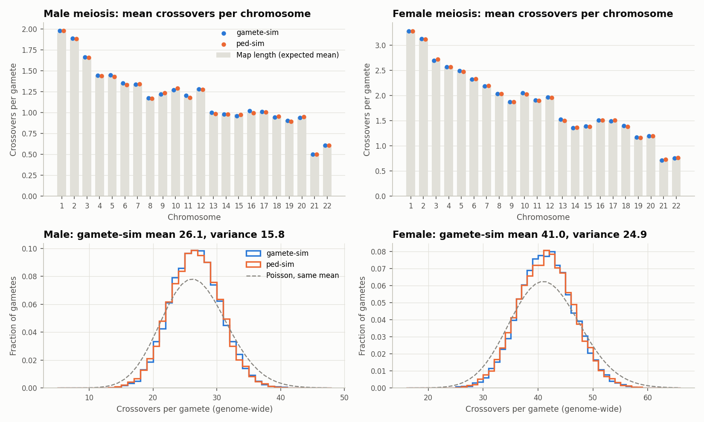
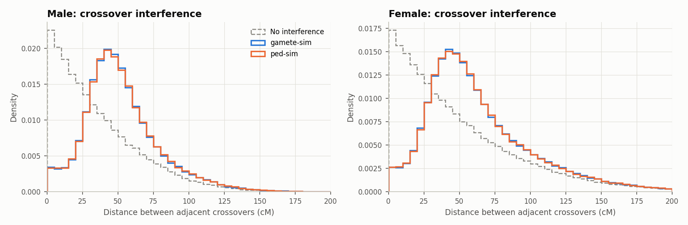
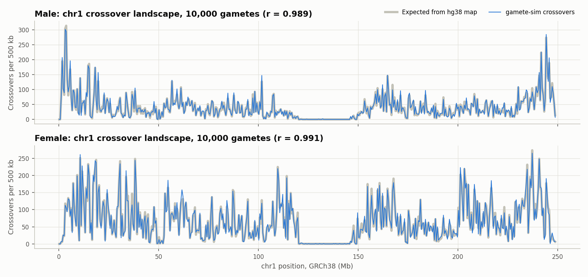

# gamete-sim: hg38-native gamete simulator

Simulates **exactly 10,000 human gametes** as GRCh38 (hg38) haplotype segments, with sex-specific recombination hotspots and crossover interference. One command, deterministic output, no liftover of simulated breakpoints.

- **Output:** `gametes_male_hg38.csv` and `gametes_female_hg38.csv`. Each file holds 10,000 gametes. Each gamete is a list of segments that tile chr1-22 from base 1 to the last base. Each segment comes from haplotype 1 or haplotype 2 of the parent.
- **Model:** the Bhérer et al. (2017) refined sex-specific EUR genetic map, lifted to hg38 once, marker by marker. The crossover model is the ped-sim / xoi Housworth-Stahl gamma model with the Campbell et al. (2015) interference parameters.
- **Checks:** the lift equals UCSC liftOver on all 781,192 map markers. The simulated crossovers agree with ped-sim v1.4.7 on the same map. Local and Docker runs give byte-identical files ([`checksums.sha256`](checksums.sha256)).

## Quick start

### Docker (recommended)

```bash
git clone https://github.com/human-genomics/gamete-sim.git && cd gamete-sim
docker build -t gamete-sim .
docker run --rm --user "$(id -u):$(id -g)" -v "$(pwd)/gamete-sim-data:/data" gamete-sim
```

Or use the image that CI publishes from `main`:

```bash
docker run --rm --user "$(id -u):$(id -g)" -v "$(pwd)/gamete-sim-data:/data" ghcr.io/human-genomics/gamete-sim:latest
```

Outputs go to `gamete-sim-data/output/`. Downloads (39 MB) are cached in `gamete-sim-data/downloads/`.

### Local

```bash
bash main.sh
```

Requirements: `python3` (3.10 to 3.14) and `curl`. The script makes a virtual environment in `tools/venv/`, downloads the inputs, and writes everything inside the repo directory. Delete the directory and nothing stays on your system.

### Settings

| Variable | Default | Meaning |
|---|---|---|
| `N_GAMETES` | `10000` | Gametes per sex |
| `SEED` | `42` | Random seed |
| `GAMETE_SIM_DATA_DIR` | repo directory (`/data` in Docker) | Location of `downloads/`, `output/`, `logs/` |
| `STRICT_CHECKSUMS` | `0` | `1`: fail if default outputs differ from `checksums.sha256` |

Docker example: `docker run --rm --user "$(id -u):$(id -g)" -e SEED=7 -v "$(pwd)/gamete-sim-data:/data" gamete-sim`.

## Output

### `output/gametes_{male,female}_hg38.csv` (main output)

One row per segment. `male` means gametes (sperm) of a male parent, simulated with the male map and male interference parameters. `female` means gametes (eggs) of a female parent.

| gamete | chrom | start | end | haplotype |
|---:|---:|---:|---:|---:|
| 1 | 1 | 1 | 1169690 | 1 |
| 1 | 1 | 1169691 | 164587277 | 2 |
| 1 | 1 | 164587278 | 248956422 | 1 |
| 1 | 2 | 1 | 9943659 | 1 |
| 1 | 2 | 9943660 | 217800403 | 2 |
| 1 | 2 | 217800404 | 242193529 | 1 |

| Column | Meaning |
|---|---|
| `gamete` | 1 to 10,000 |
| `chrom` | 1 to 22 |
| `start`, `end` | GRCh38 positions, **1-based and inclusive** (the VCF `POS` convention) |
| `haplotype` | `1` or `2`: the parent's haplotype that the gamete carries in this segment |

**Coordinate rules.** These are true for every gamete and chromosome, and `gamete-sim report` checks them on every run:

- The first segment starts at `1`. The last segment ends at the GRCh38 chromosome length (for example 248,956,422 for chr1).
- A segment starts at `1` or at the previous segment's `end + 1`. A segment ends at the chromosome length or at the next segment's `start - 1`. There are no gaps and no overlaps.
- The haplotype changes at every segment boundary. Each boundary is one crossover, between base `end` and base `end + 1`.
- Rows are sorted by `gamete`, `chrom`, `start`. The number of crossovers on a chromosome is its number of rows minus 1.

**What haplotype 1 and 2 mean.** They are the two phased haplotypes of the parent that makes the gametes. With a phased VCF genotype `a|b`, haplotype 1 is `a` (first allele) and haplotype 2 is `b`. If your phasing puts the maternal haplotype first (for example trio phasing with that convention), then 1 = maternal (from the parent's mother) and 2 = paternal. The model is symmetric: the first haplotype on each chromosome is a fair coin flip, so the labels do not change the simulation. What does matter is the parent's sex: use the `male` file for a father's sperm and the `female` file for a mother's eggs.

**Allele of gamete `g` at a variant `chrom:POS`.** Find the row with `gamete == g`, the same `chrom`, and `start <= POS <= end`. Take its `haplotype` `h`. The allele is the `h`-th allele of the parent's phased genotype.

### Other outputs

| File | Content |
|---|---|
| `output/genetic_map/genetic_map_hg38.tsv` | The hg38 sex-specific map: `chrom`, `pos` (hg38), `male_cM`, `female_cM`, `pos_hg19` |
| `output/genetic_map/refined_mf_hg38.simmap` | The same map in ped-sim format (`ped-sim -m`) |
| `output/genetic_map/liftover_summary.tsv` | Markers kept and dropped, and genetic length before and after the lift, per chromosome |
| `output/qc/crossover_summary.tsv` | Mean and variance of crossovers per chromosome against the map length |
| `output/qc/pedsim_concordance.tsv` | Per-chromosome comparison with ped-sim |
| `output/qc/*.png` | The validation figures below |
| `logs/run_*.log` | Full log of each run |

## Method

### 1. Genetic map on hg38

The Bhérer et al. (2017) maps are on hg19. We lift each map marker to hg38 once with the UCSC `hg19ToHg38.over.chain.gz` chain, then simulate directly on hg38. We never lift a simulated breakpoint, so no breakpoint has to be moved and no gamete is dropped, and adjacent segments stay exactly adjacent across inversions between builds.

The chain has no overlapping blocks on the hg19 side, so each hg19 base lifts to at most one hg38 base. `gamete_sim/liftover.py` does this lift with NumPy. On all 781,192 markers it gives the same chromosome and position as the UCSC `liftOver` binary (`validation/liftover_concordance.py`, run in CI).

Markers are dropped in this order:

| Filter | Markers | Reason |
|---|---:|---|
| Unmapped | 272 | Not in any chain block ("Deleted in new") |
| Other chromosome | 73 | Lifts to another chromosome or an alt/random contig |
| Duplicate | 0 | Two markers on one hg38 position |
| Out of order | 284 | Inversions and moved blocks between builds. We keep the longest run of markers whose hg19 order agrees with hg38 order. cM increases with hg19 position, so this keeps both maps monotone. |
| **Kept** | **780,563 (99.92%)** | |

The first and last marker of every chromosome lift, so the genetic length of every chromosome does not change: male 2,607.62 cM, female 4,094.25 cM (chr1-22). Only 0.11% of the genetic length sits in intervals whose physical length changed by more than 2× between builds (mostly next to centromeres).

### 2. Crossover model

For each gamete and chromosome of genetic length L (Morgans), from `gamete_sim/meiosis.py`:

1. **Interfering pathway.** Chiasmata form a stationary renewal process with Gamma(shape ν, rate 2ν(1−p)) spacing. Each chiasma goes to the gamete's chromatid with probability 1/2.
2. **Non-interfering pathway.** Poisson(pL) crossovers, uniform on the chromosome.
3. **Start haplotype.** A fair coin picks haplotype 1 or 2 at the start of the chromosome.

ν (interference strength) and p (fraction that escapes interference) are sex- and chromosome-specific (Campbell et al. 2015, as shipped with ped-sim). The mean is 1 crossover per Morgan.

This is ped-sim's `--intf` model (`COInterfere::simStahl`, itself a port of `simStahl` in Karl Broman's xoi). One change: ped-sim draws the first chiasma from a 10,000-bin approximation of the stationary start distribution. gamete-sim draws it exactly, as U × Gamma(ν+1, rate), the forward recurrence time of the renewal process.

### 3. From crossovers to hg38 segments

A crossover at genetic position g falls between two map markers. Linear interpolation gives a physical position, and its floor is the last base of the segment before the crossover (as in ped-sim). Two crossovers between the same two bases cancel. There is no genetic distance before the first marker or after the last marker of the map (for example the short arms of chr13, 14, 15, 21, 22), so no crossover happens there. The first and last segments extend to base 1 and to the chromosome end.

### Random streams

Each (sex, chromosome) pair has its own NumPy stream, `SeedSequence(SEED, spawn_key=(sex, chrom))`. A chromosome's result does not depend on the other chromosomes. NumPy, pandas and matplotlib versions are pinned exactly.

## Validation

**Output rules.** `gamete-sim report` checks every gamete file: exactly `N_GAMETES` gametes, chr1-22 in each, start at 1, end at the chromosome length, no gaps or overlaps, haplotype switch at each boundary.

**Crossover counts** (10,000 gametes per sex):

| | Map length (Morgans) | gamete-sim mean | ped-sim mean | gamete-sim variance | ped-sim variance |
|---|---:|---:|---:|---:|---:|
| Male | 26.08 | 26.15 | 26.08 | 15.76 | 15.97 |
| Female | 40.94 | 40.96 | 40.95 | 24.90 | 25.48 |

The variance is below the mean (a Poisson model gives variance = mean). This is the effect of interference. A separate run with 100,000 gametes per sex (seed 2024) gave male mean 26.076 vs 26.087, variance 16.16 vs 16.16, and female mean 40.964 vs 40.956, variance 25.63 vs 25.53 (gamete-sim vs ped-sim; all |z| < 0.7).

**Agreement with ped-sim v1.4.7.** Same hg38 map, same parameters, 10,000 gametes per sex, 44 sex × chromosome tests. Largest |z| for the difference of per-chromosome means: 2.19. Two-sample KS tests on breakpoint positions: 1 of 44 with p < 0.05 (smallest p 0.046). KS tests on the genetic distance between adjacent crossovers: 3 of 44 with p < 0.05 (smallest p 0.012). With 44 tests, about 2 are expected below 0.05 by chance.





The breakpoint density follows the fine-scale hg38 map, including hotspots and the male/female differences (500-kb bins, correlation with the expected count r = 0.989 male, 0.991 female on chr1):



**Tests.** `python -m pytest` runs 64 unit and integration tests: the chain lifter on toy chains (both strands, gaps), the marker filter, one crossover per Morgan for short and long chromosomes (this detects a wrong start distribution), variance and spacing under interference, flat stretches of the map, segment tiling, determinism, and the real-map lift.

**Reproducibility.** Runs on Linux x86_64 with NumPy 1.26.4 and 2.2.6 (Python 3.10) and NumPy 2.4.6 (Python 3.11 in the Docker image; Python 3.14 in a clean `python:3.14-slim` container) gave byte-identical files:

```
7791dd7161d90ccc5acff26ecda186224b1b9597546b18cbc1b7e8b19746c163  gametes_male_hg38.csv
11a6c943d416987540bd96a5d89dcad149554264ecf3fe050a625103b5c0e570  gametes_female_hg38.csv
be35d9769731a6615c0a02edaf5a5e88f13176db54c433b321993aff3456de5c  genetic_map/genetic_map_hg38.tsv
```

## Runtime and storage

Measured on a Linux x86_64 workstation. The pipeline uses one CPU core and about 260 MB of RAM.

| Step | Time |
|---|---:|
| Download inputs (first run) | ~5 s |
| Lift map | ~10 s |
| Simulate 10,000 + 10,000 gametes | ~2 s |
| Report (checks, ped-sim, figures) | ~10 s |
| **Docker run, empty data directory** | **~23 s** |

| Directory | Size |
|---|---:|
| `downloads/` | 38 MB |
| `output/` (gametes 28 MB, map 62 MB, ped-sim files in `qc/`) | ~130 MB |
| `tools/venv/` (local runs only) | ~250 MB |

## Directory structure

```
.
├── main.sh                  Entry point: venv, downloads, map, simulation, report, checksums
├── download.sh              Downloads the 3 inputs, verifies SHA-256
├── setup_pedsim.sh          Builds ped-sim v1.4.7 (optional, for the cross-check)
├── checksums.sha256         Expected outputs for N_GAMETES=10000, SEED=42
├── requirements.txt         Exact pins (NumPy pin depends on the Python version)
├── requirements-dev.txt     + pytest
├── Dockerfile               Two stages: builds ped-sim, then the runtime image
├── gamete_sim/
│   ├── constants.py         GRCh38 lengths, seed namespaces
│   ├── liftover.py          Chain file parser and vectorised point lift
│   ├── genetic_map.py       Bhérer map -> hg38 map
│   ├── meiosis.py           Housworth-Stahl crossover sampler
│   ├── simulate.py          Crossovers -> hg38 segments
│   ├── qc.py                Output checks and summaries
│   ├── pedsim.py            Cross-check with ped-sim
│   ├── plots.py             Figures
│   └── __main__.py          CLI: build-map, simulate, report
├── tests/                   pytest suite
├── validation/
│   └── liftover_concordance.py   gamete-sim lift vs UCSC liftOver on all markers
├── docs/                    Figures used in this README
└── .github/workflows/ci.yml Tests, full Docker run with checksum check, image publish
```

## Limitations

- **Autosomes only.** A male gamete carries the X or the Y whole (outside the PARs), and the Bhérer X map is female-only.
- **Population-average model.** The map is a European average. There is no individual variation in rate or hotspot use (for example PRDM9 alleles), no maternal-age effect on interference, and no non-crossover gene conversion.
- **Map ends.** There are no crossovers before the first or after the last map marker (telomeric ends and acrocentric short arms), because the map has no genetic length there.
- **Lift artefacts.** 0.11% of the genetic length is in intervals whose physical size changed by more than 2× between hg19 and hg38. The local rate there is diluted or concentrated to match.
- **Bitwise reproducibility** is tested on Linux x86_64. Other platforms use a different math library and can, in rare cases, round a breakpoint to a different base. Use Docker for byte-identical output.

## Data sources

| Input | Source |
|---|---|
| Sex-specific EUR genetic maps (hg19) | [cbherer/Bherer_etal_SexualDimorphismRecombination](https://github.com/cbherer/Bherer_etal_SexualDimorphismRecombination) @ `0456f74` |
| hg19 → hg38 chain | [UCSC](https://hgdownload.soe.ucsc.edu/goldenPath/hg19/liftOver/hg19ToHg38.over.chain.gz) (unchanged since 2014) |
| Interference parameters ν, p | [ped-sim `interfere/nu_p_campbell.tsv`](https://github.com/williamslab/ped-sim/tree/44d0c7abf6206479d5d6df926ecca086a8bbee32/interfere) @ `44d0c7a` (v1.4.7) |
| ped-sim (cross-check only) | [williamslab/ped-sim](https://github.com/williamslab/ped-sim) @ `44d0c7a` (v1.4.7) |

## Citations

- Bhérer C, Campbell CL, Auton A. Refined genetic maps reveal sexual dimorphism in human meiotic recombination at multiple scales. *Nat Commun* 8, 14994 (2017).
- Campbell CL, Furlotte NA, Eriksson N, Hinds D, Auton A. Escape from crossover interference increases with maternal age. *Nat Commun* 6, 6260 (2015).
- Caballero M, Seidman DN, Qiao Y, et al., Williams AL. Crossover interference and sex-specific genetic maps shape identical by descent sharing in close relatives. *PLoS Genet* 15(12), e1007979 (2019). [ped-sim](https://github.com/williamslab/ped-sim).
- Housworth EA, Stahl FW. Crossover interference in humans. *Am J Hum Genet* 73, 188-197 (2003).
- Broman KW. xoi: Analysis of crossover interference. [github.com/kbroman/xoi](https://github.com/kbroman/xoi).
- Hinrichs AS, Karolchik D, Baertsch R, et al. The UCSC Genome Browser Database: update 2006. *Nucleic Acids Res* 34, D590-D598 (2006).

## License

GPL-3.0-or-later. `gamete_sim/meiosis.py` ports GPL-3.0 code from ped-sim (Amy Williams lab), which ports xoi (Karl Broman).
